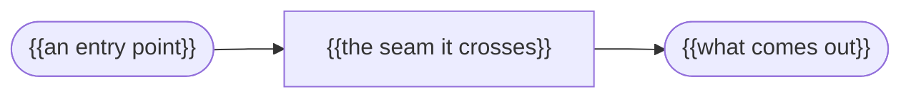

# {{SYSTEM NAME}}

## In one paragraph

{{What this system is for, in time order, and what a reader should be able to predict after this page. One paragraph — the only prose on the page.}}

## How it works

### The shape

- {{Directory or package, and the one responsibility it owns. Five or six entries; not all of them — the ones a change touches.}}

### The seams

- {{Where the system crosses itself, and the rule about crossing it. Name the thing that enforces the rule — a lint config, a type, a constructor, a test — or write "nothing enforces it" and put it under Unverified.}}

### The trails

- {{Entry point, one line each, linking to the story page that traces it. An entry point with no story belongs in the deadfall list, not here.}}

### The bog — invariants

| Invariant | What enforces it | Where |
| --- | --- | --- |
| {{a rule that must stay true}} | {{the lint rule, type, assertion or test}} | {{file and symbol}} |

### The deadfall

- {{What is abandoned, deprecated, unreferenced, or in no repository — and how you know.}}

## Diagram

## Where it lives

| What | Repository | Path |
| --- | --- | --- |
| {{the part}} | {{project}} | `{{path/to/file}}` |

## What breaks if you change it

| Change | What happens | How you would find out |
| --- | --- | --- |
| {{edit}} | {{effect}} | {{the test, the log line, the symptom}} |

## Unverified

- **{{the claim you could not settle.}}** Settle: `{{the command}}`.
