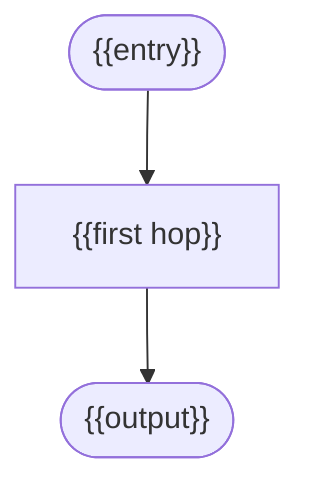

# {{a thing does something}} — a story

## In one paragraph

{{Where it enters, what carries it, where it leaves as something else — in time order. One paragraph.}}

## How it works

### Where it enters

- {{the click, the commit, the tag, the request, the cron — and what a reader would do to trigger it}}

### What comes in

- {{the input, named as the field or variable it actually is}}

### The hops

| Hop | What it decides | Where it is decided |
| --- | --- | --- |
| {{the job, script or function}} | {{the decision}} | `{{file}}`, {{symbol}} |

### What is code, and what is your policy

| The reader can change | Whether it is code or policy |
| --- | --- |
| {{the behaviour}} | **code** — {{where}} |
| {{the input or setting}} | **policy** — {{where it is set}} |

### What goes out

- {{the output, and the place it lands}}

## Diagram

## Where it lives

| What | Repository | Path |
| --- | --- | --- |
| {{the hop}} | {{project}} | `{{path/to/file}}` |

## What breaks if you change it

| Change | What happens | How you would find out |
| --- | --- | --- |
| {{edit}} | {{effect}} | {{the test, the log line, the symptom}} |

## Unverified

- **{{what you could not observe.}}** Settle: `{{the command}}`.
